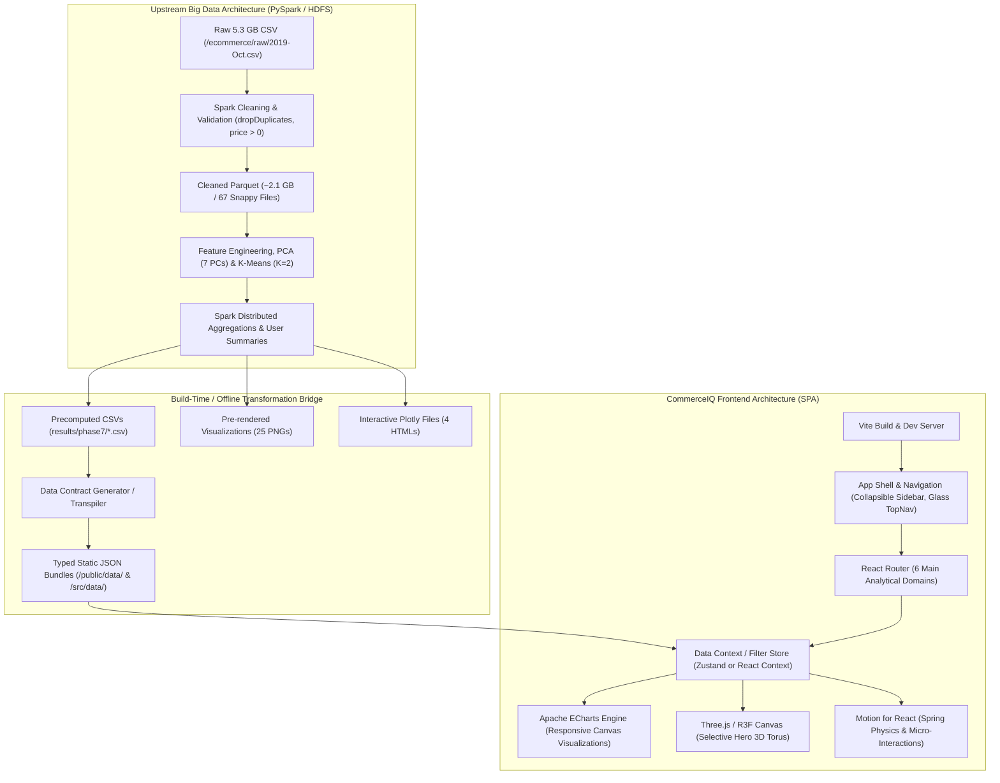

# CommerceIQ — Technical Architecture & Engineering Specification

**Document ID:** `CIQ-M00-ARCH`  
**Version:** 1.0.0  
**Status:** Approved for Implementation  
**Author:** Principal Frontend Architect & Senior Systems Engineer  

---

## 1. System Vision & Architectural Objectives

**CommerceIQ** is an executive-grade e-commerce intelligence web application built to deliver seamless, low-latency analytical exploration over 42.4 million recorded behavioral transactions from October 2019.

The architecture decouples the presentation layer from the original Python Streamlit runtime, migrating the experience to a modern client-side Single Page Application (SPA). By leveraging precomputed analytical summaries, strongly typed contracts, vector-based interactive graphics (Apache ECharts), and selective WebGL acceleration (Three.js), CommerceIQ achieves zero server-roundtrip latency, instant filtering, and responsive fluid animations.



---

## 2. Technology Stack & Rationale

| Layer | Selected Technology | Version | Rationale & Selection Criteria |
| :--- | :--- | :--- | :--- |
| **Runtime & Framework** | **React** + **TypeScript** | React 18.3+ / TS 5.4+ | Industry standard for complex dashboard state, component modularity, and strict compile-time type safety. |
| **Build Tooling** | **Vite** | 5.3+ | Near-instant HMR, optimized Rollup production bundling, native ESM, and clean asset hashing. |
| **Styling & CSS** | **Tailwind CSS** + PostCSS | 3.4+ | Utility-first architecture, zero runtime CSS bloat, exact custom token mapping (`tailwind.config.js`), responsive breakpoints. |
| **Data Visualization** | **Apache ECharts** | 5.5+ (`echarts-for-react` or custom hook) | Exceptional performance with large datasets, rich visual depth (smooth gradients, dark-mode themes, radar, treemap, sunburst), lightweight vector canvas rendering. Replaces 4.8 MB Plotly iframes. |
| **Selective 3D Engine** | **Three.js** | 0.165+ | High-performance WebGL abstraction for the signature Overview Data Torus. Low-poly, hardware-accelerated, zero DOM overhead. |
| **Micro-Interactions** | **Motion for React** (`framer-motion`) | 11.2+ | Natural spring physics, layout animations, exit animations, and automatic `prefers-reduced-motion` compliance. |
| **Iconography** | **Lucide React** | 0.395+ | Consistent 24px grid, highly legible line icons, tree-shakeable SVG footprint. |
| **Data Parsing & Utilities** | **PapaParse** / Native JSON imports | 5.4+ | High-throughput client-side parsing and validation of precomputed tabular data. |

---

## 3. Directory Layout & Architecture Boundaries

All frontend code will reside in a dedicated `frontend/` directory, completely isolated from the original Streamlit project files (`dashboard/`, `results/`, `data/`).

```
c:/Users/madhur/Downloads/ecommerce/
├── docs/commerceiq/                               # M00 Architecture, Audit, Design Docs
├── ecommerce_bigdata_showcase/                    # Original Project (Unmodified / Read-Only)
│   ├── dashboard/                                 # Legacy Streamlit app
│   ├── data/summary/                              # Original metrics
│   ├── results/                                   # Precomputed CSVs and PNGs
│   └── reports/                                   # Technical reports
└── frontend/                                      # CommerceIQ React Implementation
    ├── index.html                                 # HTML5 entry with dark canvas background
    ├── package.json                               # Dependencies & build scripts
    ├── tsconfig.json                              # Strict TypeScript configuration
    ├── vite.config.ts                             # Vite configuration with chunk splitting
    ├── tailwind.config.js                         # Design system tokens & animations
    ├── postcss.config.js
    ├── public/
    │   ├── data/                                  # Static precomputed JSON/CSV data files
    │   ├── images/                                # Static high-res PNG visualization artifacts
    │   └── favicon.svg                            # CommerceIQ brand mark
    └── src/
        ├── main.tsx                               # Application bootstrap
        ├── App.tsx                                # Root component & layout wrapper
        ├── router/
        │   └── index.tsx                          # Route definitions (6 navigation views)
        ├── types/                                 # Centralized TypeScript Data Contracts
        │   ├── metrics.ts                         # KPI and summary data interfaces
        │   ├── analytics.ts                       # Time series, brand, and category types
        │   ├── ml.ts                              # PCA and K-Means segmentation types
        │   └── navigation.ts                      # Routing and filter state types
        ├── data/                                  # Typed static data loaders & constants
        │   ├── verifiedMetrics.ts                 # Source from verified_project_metrics.csv
        │   ├── descriptiveAnalytics.ts            # Source from phase7 CSV summaries
        │   ├── pcaClustering.ts                   # Source from PCA and K-Means experiments
        │   └── galleryManifest.ts                 # Manifest of 29 original plot artifacts
        ├── store/                                 # Lightweight state management
        │   ├── DataContext.tsx                    # Shared analytical dataset provider
        │   └── FilterContext.tsx                  # Global time/category/brand filter state
        ├── hooks/                                 # Custom React hooks
        │   ├── useAnalyticsData.ts                # Data access with loading & error states
        │   ├── useChartResize.ts                  # Debounced ResizeObserver for ECharts
        │   └── useReducedMotion.ts                # System accessibility preference hook
        ├── components/
        │   ├── layout/                            # Layout shell components
        │   │   ├── AppShell.tsx                   # Main layout container
        │   │   ├── Sidebar.tsx                    # Collapsible dark navigation sidebar
        │   │   ├── TopNav.tsx                     # Glass header with search & status tags
        │   │   └── Footer.tsx                     # Academic citation & data provenance footer
        │   ├── common/                            # Reusable Design System UI primitives
        │   │   ├── Card.tsx                       # Glass/elevated container with hover physics
        │   │   ├── MetricCard.tsx                 # Standardized KPI card with sparkline/delta
        │   │   ├── Badge.tsx                      # Status and category pills
        │   │   ├── Button.tsx                     # Primary, secondary, outline buttons
        │   │   ├── Tabs.tsx                       # Accessible tabbed panels
        │   │   ├── DataTable.tsx                  # Sortable, searchable virtualized table
        │   │   ├── Tooltip.tsx                    # Contextual informational popover
        │   │   └── DisclaimerBanner.tsx           # Methodological caveat alert box
        │   ├── charts/                            # Unified ECharts wrapper components
        │   │   ├── BaseChart.tsx                  # Core ECharts canvas lifecycle wrapper
        │   │   ├── TrendLineChart.tsx             # Hourly & daily revenue/event area charts
        │   │   ├── RankingBarChart.tsx            # Category & brand ranking bar charts
        │   │   ├── EventFunnelChart.tsx           # 3-stage view->cart->purchase funnel
        │   │   ├── DistributionPieChart.tsx       # Donut / Pie distributions
        │   │   ├── HierarchicalTreemap.tsx        # Category/brand revenue treemap
        │   │   └── ScreeBarChart.tsx              # PCA explained variance scree plot
        │   └── 3d/                                # Selective WebGL visual components
        │       ├── CommerceNexusScene.tsx         # Bounded Three.js canvas container
        │       └── TorusKnotMesh.tsx              # Wireframe data sculpture with glow shader
        └── views/                                 # The 6 Proposed Navigation Screens
            ├── OverviewView.tsx                   # 1. Executive Summary & Nexus Hero
            ├── SalesIntelligenceView.tsx          # 2. Revenue, Time Trends & Decoupling
            ├── CustomerIntelligenceView.tsx       # 3. K-Means Segments & User Activity
            ├── DataExplorerView.tsx               # 4. Searchable Merchandising Tables
            ├── MLInsightsView.tsx                 # 5. PCA Scree, Correlation, Clustering
            └── DataPipelineView.tsx               # 6. Spark Architecture, Cleaning & Audit
```

---

## 4. Navigation Architecture & Information Hierarchy

The navigation structure directly mirrors the 6 core analytical domains required by executive commerce analysts:

```
[CommerceIQ Suite]
│
├── 1. Overview Screen (Executive Command Center)
│   ├── Hero Nexus: 3D Data Torus & Macro KPI Highlights
│   ├── Quick Status: 42.3M Cleaned Events, ₹229.9M Revenue, 3.02M Users
│   ├── Revenue & Activity Trend (Daily Progression)
│   ├── Event Funnel (View → Cart → Purchase Event Ratios)
│   ├── Category Revenue Dominance (Top 5 Categories)
│   └── Customer Segmentation Breakdown (8.29% High Activity vs 91.71% Low Activity)
│
├── 2. Sales Intelligence
│   ├── Daily Revenue Trajectory (With Nov 1 UTC Boundary Marker)
│   ├── Temporal Decoupling: Peak Activity (21:00) vs Peak Revenue (14:00)
│   ├── Day-of-Week Purchasing Concentration (Wednesday Peak)
│   ├── Price Bracket Contribution (Under ₹50 to ₹1000+)
│   └── Brand Pareto Analysis (Apple & Samsung 68.5% Share)
│
├── 3. Customer Intelligence
│   ├── Final K=2 Behavioral Segmentation Deep-Dive
│   ├── Segment Profile Comparison Matrix (Purchases, Carts, Sessions, Basket Breadth)
│   ├── User Activity Tier Distribution (1–5 Events to >50 Events)
│   ├── Buyer vs. Browser Disparity Analysis
│   └── Extreme Outlier Case Study (7,429 views, 0 purchases)
│
├── 4. Data Explorer
│   ├── Searchable, Sortable Brand Revenue Table (1,986 Brands)
│   ├── Category Hierarchy & Performance Table (14 Main Categories)
│   ├── Top Products Leaderboard (Top by Revenue & Top by Purchase Volume)
│   ├── Interactive Filter Controls (Category Filter, Revenue Range, Buyer Minimum)
│   └── Clean CSV Export for Auditing
│
├── 5. ML Insights
│   ├── PCA Dimensionality Reduction (7 Components, 95.967% Explained Variance)
│   ├── Scree Plot & Cumulative Variance Curve
│   ├── Numeric Feature Correlation Matrix (Price vs Log-Price vs Scaled Variables)
│   ├── K-Means Model Selection Comparison (K=2 to K=5 Silhouette Scores)
│   └── Methodological Caveats & Model Limitations
│
└── 6. Data Pipeline & Provenance
    ├── End-to-End Spark/HDFS Pipeline Architecture Diagram
    ├── Data Cleaning & Validation Audit (98,890 records removed)
    ├── Outlier Diagnostics (IQR 8.69% vs Z-Score 2.74%)
    ├── Missing Value Strategies (Unknown Category/Brand Handling)
    └── Technical Report Summary (PDF Artifact Reference & Verification Notes)
```

---

## 5. Data Flow & Loading Strategy

To ensure instant screen transitions and zero runtime infrastructure requirements, CommerceIQ utilizes a **hybrid typed static data architecture**:

```mermaid
sequenceDiagram
    autonumber
    actor User
    participant Shell as AppShell
    participant Router as React Router
    participant Store as Data Provider
    participant View as OverviewView
    participant ECharts as ECharts Instance
    participant WebGL as Three.js Canvas

    User->>Shell: Opens CommerceIQ
    Shell->>Store: Initialize in-memory typed datasets
    Note over Store: Bundled JSON & typed modules load in < 15ms
    Store-->>Router: Datasets Ready
    Router->>View: Mount OverviewView
    View->>WebGL: Initialize Bounded Three.js Torus (60 FPS)
    View->>ECharts: Render Event Funnel & Daily Trend
    ECharts-->>User: Visualizations interactive with smooth entrance physics
    
    User->>View: Clicks "Sales Intelligence"
    Router->>View: Fast Client Route Transition (< 50ms)
    Note over View: Zero network roundtrip; data served from memory store
```

### 5.1 Precomputed Dataset Optimization
* Instead of running PapaParse dynamically on large CSVs at client startup, an automated build-time conversion script (`scripts/convert-csv-to-json.ts`) transforms the original `results/phase7/*.csv` into optimized, strongly-typed JSON files.
* For very large datasets (e.g., `brand_revenue.csv` with 1,986 rows, ~50 KB), the data is lazily imported when navigating to the **Data Explorer** view, keeping the initial bundle lean.
* Total precomputed data payload for the entire application is **under 120 KB gzipped**, allowing instant offline-capable execution.

---

## 6. Performance Budget & Engineering Constraints

To ensure CommerceIQ runs at 60 FPS on standard enterprise laptops and mobile devices, the following performance budgets are strictly enforced:

| Metric | Target Budget | Enforcement Mechanism |
| :--- | :--- | :--- |
| **Initial Bundle Size (JS)** | `< 250 KB` gzipped | Vite manual code splitting (`echarts`, `three`, `lucide-react` chunked into separate async vendor bundles). |
| **Initial Bundle Size (CSS)** | `< 25 KB` gzipped | Tailwind CSS Purge / JIT compiler eliminates all unused classes. |
| **Total Precomputed Data Payload** | `< 120 KB` gzipped | Normalized JSON structures, stripping redundant whitespace and header rows. |
| **First Contentful Paint (FCP)** | `< 1.0s` | Static HTML shell with inline dark background; zero render-blocking external stylesheets. |
| **Time to Interactive (TTI)** | `< 1.8s` | Fast hydration, deferred Three.js canvas mount via `requestIdleCallback`. |
| **3D Canvas Draw Calls** | `≤ 4 calls / frame` | Single merged geometry, standard custom wireframe shader, low poly count. |
| **3D Memory Footprint** | `< 20 MB VRAM` | 128x32 torus knot geometry; 1,200 particle vertices; clean WebGL context disposal on unmount. |
| **Chart Re-render Performance** | `< 16ms` (60 FPS) | ECharts `notMerge: false` incremental updates; debounced window resize observer. |
| **Lighthouse Performance Score** | `≥ 95 / 100` | Automated CI audit for Performance, Accessibility, and Best Practices. |

---

## 7. WebGL & Canvas Lifecycle Safety

A common failure mode in complex dashboard SPAs is WebGL context leakage and memory accumulation during route transitions. CommerceIQ implements bulletproof cleanup lifecycles:

```typescript
// Memory-safe Three.js mounting pattern
useEffect(() => {
  const container = containerRef.current;
  if (!container) return;

  const renderer = new THREE.WebGLRenderer({ antialias: true, alpha: true, powerPreference: 'high-performance' });
  renderer.setPixelRatio(Math.min(window.devicePixelRatio, 2));
  renderer.setSize(container.clientWidth, container.clientHeight);
  container.appendChild(renderer.domElement);

  // Setup Scene, Camera, Geometry, ShaderMaterial...

  let animationFrameId: number;
  const animate = () => {
    animationFrameId = requestAnimationFrame(animate);
    mesh.rotation.y += 0.003;
    renderer.render(scene, camera);
  };
  animate();

  return () => {
    cancelAnimationFrame(animationFrameId);
    renderer.dispose();
    geometry.dispose();
    material.dispose();
    if (container.contains(renderer.domElement)) {
      container.removeChild(renderer.domElement);
    }
  };
}, []);
```

---

*Approved for Milestone M01 implementation.*
