# CommerceIQ — Data Contracts & Transformation Specifications

**Document ID:** `CIQ-M00-CONTRACTS`  
**Version:** 1.0.0  
**Status:** Approved for Implementation  
**Author:** Principal Frontend Architect & Senior Data Engineer  

---

## 1. Data Ingestion Architecture & Provenance

To guarantee that CommerceIQ runs with zero runtime dependencies on Hadoop, HDFS, or PySpark, precomputed analytical artifacts from `results/phase7/` and `data/summary/` are compiled into strongly-typed static JSON modules.

Every metric, curve point, and table row displayed in the application is strictly derived from verified source data. This document formalizes the exact TypeScript interfaces, serialization formats, validation guards, and string normalization rules.

```mermaid
flowchart LR
    subgraph Source_Artifacts["Source CSV Files (Original Repository)"]
        CSV1["verified_project_metrics.csv"]
        CSV2["results/phase7/daily_purchase_summary.csv"]
        CSV3["results/phase7/hourly_activity.csv & revenue.csv"]
        CSV4["results/phase7/category_revenue.csv"]
        CSV5["results/phase7/brand_revenue.csv (1,986 rows)"]
        CSV6["results/phase7/top_products_*.csv"]
        CSV7["results/phase7/purchase_price_distribution.csv"]
        CSV8["results/phase7/user_activity_distribution.csv"]
    end

    subgraph Transformation_Engine["Build-Time Sanitization & Typing (scripts/transpile-data.ts)"]
        Parser["PapaParse / CSV Stream"]
        Cleaner["UTF-8 Normalizer (En-dash \\xe2\\x80\\x93 Fix)"]
        TypeCaster["Strict Numeric & Date Type Casting"]
        Precision["IEEE 754 Rounding Sanitizer"]
    end

    subgraph TypeScript_Data_Modules["Typed JSON & Static TS Contracts (frontend/src/data/)"]
        TS1["verifiedMetrics.json"]
        TS2["salesTrends.json"]
        TS3["categoryBrandCatalog.json"]
        TS4["productLeaderboard.json"]
        TS5["customerSegmentation.json"]
        TS6["mlInsights.json"]
    end

    Source_Artifacts --> Parser --> Cleaner --> TypeCaster --> Precision --> TypeScript_Data_Modules
```



---

## 2. Core TypeScript Interfaces

### 2.1 Macro Project Metrics (`verified_project_metrics.csv`)
```typescript
/**
 * Master project-level verified statistics from Spark processing.
 */
export interface VerifiedProjectMetrics {
  raw_records: number;             // 42,448,764
  cleaned_records: number;         // 42,349,874
  net_records_removed: number;     // 98,890
  phase5_columns: number;          // 21
  phase6_columns: number;          // 16
  users: number;                   // 3,021,435
  sessions: number;                // 9,239,403
  purchase_events: number;         // 742,773
  purchase_revenue: number;        // 229,933,212.63
  view_events: number;             // 40,708,807
  cart_events: number;             // 898,294
  price_mean: number;              // 290.7840088
  price_median_purchase: number;   // 179.84
  iqr_outlier_events: number;      // 3,677,875 (Upper fence: 796.465)
  zscore_outlier_events: number;   // 1,158,750 (|z| > 3, price > 1,365.97)
}
```

### 2.2 Event Distribution & Funnel Ratios (`event_distribution.csv`)
```typescript
export type EventType = 'view' | 'cart' | 'purchase';

export interface EventDistributionRecord {
  event_type: EventType;
  count: number;
  percentage_of_total: number;     // Computed: (count / 42,349,874) * 100
  ratio_to_views: number;          // Computed: (count / 40,708,807) * 100
}

export interface FunnelStageContract {
  stage: EventType;
  label: string;
  count: number;
  step_ratio_percent: number;      // View->Cart (2.21%), Cart->Purchase (82.69%)
  disclaimer: string;              // "Event ratios only; not session conversion rate"
}
```

### 2.3 Temporal Dynamics & Sales Intelligence
```typescript
/**
 * Daily aggregate from daily_purchase_summary.csv
 */
export interface DailySalesSummary {
  event_date: string;              // ISO date: 'YYYY-MM-DD' (2019-10-01 to 2019-11-01)
  purchase_events: number;
  total_revenue: number;
  average_order_value: number;     // Computed: total_revenue / purchase_events
  is_partial_day: boolean;         // true for 2019-11-01 (UTC boundary capture)
}

/**
 * Hourly event activity and revenue from hourly_activity.csv & hourly_revenue.csv
 */
export interface HourlyDynamics {
  event_hour: number;              // 0 to 23
  event_count: number;             // Peak: Hour 21 (3,055,061 events)
  total_revenue: number;           // Peak: Hour 14 (₹17,531,268.91)
  revenue_per_event: number;       // Computed: total_revenue / event_count
}

/**
 * Weekday aggregate from weekday_purchase_summary.csv
 */
export interface WeekdaySalesSummary {
  weekday: 'Monday' | 'Tuesday' | 'Wednesday' | 'Thursday' | 'Friday' | 'Saturday' | 'Sunday';
  purchase_events: number;
  total_revenue: number;
  share_of_weekly_revenue: number; // Computed percentage
}
```

### 2.4 Merchandising: Categories, Brands & Products
```typescript
/**
 * Category revenue aggregate from category_revenue.csv (14 categories)
 */
export interface CategoryRevenueRecord {
  main_category: string;           // 'electronics', 'Unknown', 'appliances', etc.
  total_revenue: number;
  purchase_events: number;
  unique_buyers: number;
  average_revenue_per_buyer: number; // Computed: total_revenue / unique_buyers
  revenue_share_percentage: number;  // Computed: (total_revenue / 229,933,212.63) * 100
}

/**
 * Brand revenue aggregate from brand_revenue.csv (1,986 brands)
 */
export interface BrandRevenueRecord {
  brand: string;                   // 'apple', 'samsung', 'xiaomi', 'Unknown', etc.
  total_revenue: number;
  purchase_events: number;
  unique_buyers: number;
  average_order_value: number;     // Computed: total_revenue / purchase_events
  revenue_share_percentage: number;  // Computed percentage of total platform revenue
  pareto_rank?: number;            // 1 to 1986
  cumulative_revenue_percent?: number; // Running sum up to 100%
}

/**
 * Top Product records from top_products_revenue.csv & top_products_purchase_count.csv
 */
export interface TopProductRecord {
  product_id: number;              // e.g. 1005115, 1004856
  total_revenue: number;
  purchase_events: number;
  unique_buyers: number;
  average_price: number;           // Computed: total_revenue / purchase_events
  rank_by_revenue?: number;
  rank_by_volume?: number;
}
```

### 2.5 Distribution & Segmentation Contracts
```typescript
/**
 * Price range distribution from purchase_price_distribution.csv
 */
export interface PriceDistributionRecord {
  price_range_raw: string;         // '50–99.99' (cleaned from UTF-8 \xe2\x80\x93)
  price_range_display: string;     // '₹50 – ₹99.99'
  min_price: number;               // 50
  max_price: number | null;        // 99.99 (null for 1000 and above)
  purchase_events: number;
  total_revenue: number;
  revenue_share: number;
}

/**
 * User engagement tiers from user_activity_distribution.csv
 */
export interface UserActivityTierRecord {
  activity_group_raw: string;      // '1–5 events' (cleaned from UTF-8)
  activity_group_display: string;  // '1 to 5 events'
  user_count: number;
  user_share_percentage: number;   // (user_count / 3,021,435) * 100
}

/**
 * K-Means Customer Segment from final K=2 sensitivity model
 */
export interface CustomerSegmentProfile {
  cluster_id: 0 | 1;
  cluster_name: string;            // 'Cluster 0 · High Activity' | 'Cluster 1 · Low Activity'
  user_count: number;              // 250,388 vs 2,771,046
  user_share_percent: number;      // 8.29% vs 91.71%
  average_events: number;          // 85.43 vs 7.56
  average_views: number;           // 82.00 vs 7.28
  average_carts: number;           // 1.849 vs 0.157
  average_purchases: number;       // 1.580 vs 0.125
  average_revenue: number;         // 520.86 vs 35.91
  average_sessions: number;        // 12.26 vs 2.22
  unique_products: number;         // 42.04 vs 4.60
}

/**
 * PCA Explained Variance Table
 */
export interface PCAComponentVariance {
  component: 'PC1' | 'PC2' | 'PC3' | 'PC4' | 'PC5' | 'PC6' | 'PC7';
  explained_variance_percent: number;
  cumulative_variance_percent: number;
  primary_interpretation: string;
}

/**
 * K-Means Silhouette Scores Comparison
 */
export interface KMeansExperimentScore {
  experiment: string;
  clusters_k: number;
  outlier_excluded: boolean;
  user_population: number;
  silhouette_score: number;
  is_selected: boolean;
}
```

---

## 3. Data Cleansing & Sanitization Rules

The build-time transpilation pipeline (`scripts/transpile-data.ts`) applies several deterministic rules to source files:

### 3.1 UTF-8 En-Dash Normalization (`\xe2\x80\x93`)
* **Problem:** Source CSV files `purchase_price_distribution.csv` and `user_activity_distribution.csv` encode the range separator using UTF-8 en-dash (`\xe2\x80\x93`). When viewed under certain local code pages, this becomes corrupted into `?"` or ``.
* **Normalization Logic:**
  ```typescript
  export function sanitizeRangeString(input: string): string {
    return input
      .replace(/\u2013|\u2014|\xe2\x80\x93/g, '–') // standard Unicode en-dash
      .replace(/\s*–\s*/g, ' – ')
      .trim();
  }
  ```

### 3.2 Currency & Decimal Rounding Normalization
* **Problem:** Raw sums in CSV contain IEEE 754 floating-point artifacts (e.g., `111199495.70000108` or `176445577.86001062`).
* **Normalization Logic:**
  ```typescript
  export function roundCurrency(val: number): number {
    return Math.round((val + Number.EPSILON) * 100) / 100;
  }
  ```

### 3.3 Handling of Missing Data & the `"Unknown"` Category
* The string `"Unknown"` is preserved as a legitimate categorical entity in category and brand analyses.
* The frontend treats `"Unknown"` consistently:
  * In tables, `"Unknown"` is badged with a subtle gray pill (`Unknown / Unspecified`).
  * In charts, `"Unknown"` has a dedicated muted color token (`#64748B`), keeping prominent colorways for known brands (`Apple`, `Samsung`, etc.).

---

## 4. UI Formatting Helpers & Value Translators

All formatting across CommerceIQ is centralized in `src/utils/formatters.ts` to ensure mathematical and linguistic consistency:

```typescript
/**
 * Formats integers with comma separation.
 * Example: 42349874 -> "42,349,874"
 */
export function formatInteger(val: number | null | undefined): string {
  if (val === null || val === undefined || isNaN(val)) return '—';
  return new Intl.NumberFormat('en-IN', { maximumFractionDigits: 0 }).format(val);
}

/**
 * Formats currency values in INR (₹) with exact two decimals.
 * Example: 229933212.63 -> "₹229,933,212.63"
 */
export function formatCurrency(val: number | null | undefined): string {
  if (val === null || val === undefined || isNaN(val)) return '—';
  return new Intl.NumberFormat('en-IN', {
    style: 'currency',
    currency: 'INR',
    minimumFractionDigits: 2,
    maximumFractionDigits: 2,
  }).format(val);
}

/**
 * Formats compact numbers for KPI badges and chart axes.
 * Example: 229933212.63 -> "₹229.93M", 42349874 -> "42.35M"
 */
export function formatCompactCurrency(val: number): string {
  if (val >= 1_000_000) {
    return `₹${(val / 1_000_000).toFixed(2)}M`;
  }
  if (val >= 1_000) {
    return `₹${(val / 1_000).toFixed(1)}k`;
  }
  return `₹${val.toFixed(2)}`;
}

/**
 * Formats percentages with one or two decimal places.
 * Example: 0.08287 -> "8.29%"
 */
export function formatPercent(val: number, decimals = 2): string {
  return `${val.toFixed(decimals)}%`;
}
```

---

*Approved for Milestone M01 implementation.*
