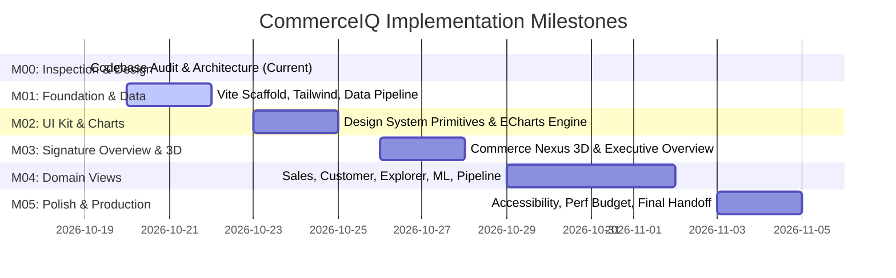

# CommerceIQ — Implementation Roadmap & Milestone Specifications

**Document ID:** `CIQ-M00-ROADMAP`  
**Version:** 1.0.0  
**Status:** Approved for Phased Execution  
**Author:** Principal Frontend Architect & Senior Engineering Manager  

---

## 1. Roadmap Overview & Phasing Strategy

The CommerceIQ implementation follows a phased milestone model (**M01 through M05**) designed to systematically transition the precomputed big-data analytics foundation into an interactive, high-performance web application.

---

## 2. Milestone M01 — Project Foundation, Design Tokens & Data Pipeline

### 2.1 Objectives & Deliverables
Establish a clean, dedicated `frontend/` directory with a modern toolchain, automated data compilation script, design system tokens, and core layout shell.

### 2.2 Detailed Task Breakdown
1. **Repository Setup:**
   * Initialize `frontend/` using Vite with the `react-ts` template.
   * Install core dependencies: `tailwindcss`, `postcss`, `autoprefixer`, `lucide-react`, `clsx`, `tailwind-merge`.
   * Configure `tsconfig.json` with strict type checking, path aliases (`@/*` pointing to `src/*`).
2. **Design System Token Configuration:**
   * Configure `tailwind.config.js` to implement color tokens (`surface-canvas`, `surface-card`, `accent-violet-primary`, `accent-cyan-primary`), typography scales, and glow box shadows.
   * Create `src/styles/globals.css` with font imports, custom scrollbar styling, and base dark midnight styles.
3. **Data Transpilation Pipeline:**
   * Create `scripts/transpile-data.ts` to read source CSVs from `ecommerce_bigdata_showcase/results/phase7/` and `data/summary/`.
   * Implement automated UTF-8 sanitization (normalizing en-dash `\xe2\x80\x93` in activity and price ranges).
   * Emit validated, strongly typed JSON modules into `frontend/src/data/`.
4. **App Shell & Routing:**
   * Build `src/components/layout/AppShell.tsx`, `Sidebar.tsx`, `TopNav.tsx`, and `Footer.tsx`.
   * Configure client-side routing via React Router with the 6 analytical views.

### 2.3 Acceptance Criteria
* `npm run dev` starts the Vite dev server with zero warnings or errors.
* `npm run transpile-data` cleanly parses all Phase 7 CSVs and outputs zero-loss JSON bundles matching the TypeScript interfaces in `DATA_CONTRACTS.md`.
* The App Shell renders in full dark midnight-navy theme with a responsive collapsible sidebar and mobile drawer.

---

## 3. Milestone M02 — Reusable UI Kit & Apache ECharts Engine

### 3.1 Objectives & Deliverables
Build the complete reusable design system component library and the custom Apache ECharts visualization engine.

### 3.2 Detailed Task Breakdown
1. **Design System UI Primitives:**
   * `Card`: Standardized dark surface container with subtle border, hover physics, and optional glow.
   * `MetricCard`: KPI card displaying large monospace tabular numerals, delta badges, and sparklines.
   * `Badge`: Status pills for categories, verified data tags, and warnings.
   * `Button`: Primary gradient buttons, outline buttons, and icon buttons.
   * `Tabs`: Accessible segmented control for sub-view navigation.
   * `DataTable`: High-performance virtualized table with search, sorting, and pagination.
   * `Tooltip`: Informational popover for data caveats.
2. **Apache ECharts Custom Integration:**
   * Install `echarts` (5.5+) and create a lightweight, memory-safe React hook `useECharts`.
   * Register the custom `commerceiq-dark` theme matching the design system specifications.
   * Build chart primitives: `TrendLineChart`, `RankingBarChart`, `EventFunnelChart`, `DistributionPieChart`, `HierarchicalTreemap`.
3. **Responsive Canvas Management:**
   * Implement debounced `ResizeObserver` lifecycle to resize charts automatically on viewport or sidebar toggles without layout shifts.

### 3.3 Acceptance Criteria
* Every UI primitive is accessible via keyboard and passes WCAG 2.1 AA color contrast standards.
* ECharts charts instantiate cleanly, render at 60 FPS, handle dark-mode tooltips with glass backdrop-blur, and dispose properly on unmount with zero memory leaks.

---

## 4. Milestone M03 — Signature Overview Experience & Selective 3D

### 4.1 Objectives & Deliverables
Implement the signature Overview screen, featuring the "Commerce Nexus" 3D WebGL data torus, macro KPI cards, revenue trendline, event funnel, and customer segment snapshot.

### 4.2 Detailed Task Breakdown
1. **Selective 3D WebGL Visualization:**
   * Install `three` (0.165+) and develop `src/components/3d/CommerceNexusScene.tsx`.
   * Create the procedural wireframe Torus Knot (`TorusKnotGeometry(1.6, 0.45, 128, 32)`) with a custom emissive gradient shader (violet to cyan).
   * Implement smooth axial rotation, mouse-follow parallax, and metric hover reactivity.
   * Add `IntersectionObserver` to pause the WebGL render loop when scrolled offscreen.
   * Provide a lightweight CSS fallback for mobile viewports (`< 640px`) and `prefers-reduced-motion`.
2. **Overview Screen Assembly (`OverviewView.tsx`):**
   * Assemble the Hero Nexus banner with dynamic KPI readouts.
   * Bind the 4 primary KPI cards: Total Revenue (₹229.93M), Cleaned Events (42.35M), Analyzed Users (3.02M), Recorded Sessions (9.24M).
   * Render the Daily Purchase Revenue & Activity trajectory chart (with Oct 16 peak and Nov 1 UTC boundary marker).
   * Render the Event Funnel with explicit event ratio labels and methodology tooltips.
   * Integrate Category Revenue ranking and the K=2 customer segment snapshot.
3. **Motion Orchestration:**
   * Implement staggered entrance animations using Motion for React.

### 4.3 Acceptance Criteria
* The 3D canvas stays strictly within budget: $\le 4$ draw calls per frame, $< 20$ MB VRAM, locked 60 FPS on desktop GPUs.
* All displayed figures match verified source metrics exactly.
* The Overview screen delivers an executive aesthetic that feels like a production intelligence terminal.

---

## 5. Milestone M04 — Domain Views Implementation (Screens 2–6)

### 5.1 Objectives & Deliverables
Deliver the remaining 5 analytical domain screens, ensuring every facet of the underlying research is fully represented with interactive controls.

### 5.2 Detailed Task Breakdown
1. **Screen 2: Sales Intelligence (`SalesIntelligenceView.tsx`):**
   * Temporal Decoupling Chart: Dual-axis comparison of hourly event volume (Peak 21:00 UTC) vs. hourly purchase revenue (Peak 14:00 UTC).
   * Weekday analysis highlighting Wednesday's peak (₹37.13M) and Saturday's trough.
   * Price distribution tiers with double-bar comparison of event counts vs revenue contribution.
   * Brand Pareto chart illustrating Apple and Samsung's 68.5% revenue dominance.
2. **Screen 3: Customer Intelligence (`CustomerIntelligenceView.tsx`):**
   * K-Means Segment Comparison Matrix: Cluster 0 (High Activity, 8.29%) vs. Cluster 1 (Low Activity, 91.71%).
   * User engagement frequency tier distribution (1–5 events up to >50 events).
   * Outlier deep-dive case study: Dedicated analysis of the 7,429-view extreme browsing user.
3. **Screen 4: Data Explorer (`DataExplorerView.tsx`):**
   * Searchable, paginated, and sortable brand revenue table for all 1,986 brands.
   * Category hierarchy catalog and top products leaderboards (by revenue and volume).
   * Real-time client-side filter controls with instant debounced search and CSV export action.
4. **Screen 5: ML Insights (`MLInsightsView.tsx`):**
   * PCA Scree Plot & Cumulative Variance curve (7 principal components explaining 95.967% variance).
   * Numeric feature correlation matrix and price log-transformation skewness reduction documentation.
   * K-Means model evaluation table with silhouette scores ($K=2$ through $K=5$).
5. **Screen 6: Data Pipeline & Provenance (`DataPipelineView.tsx`):**
   * Interactive architecture flow diagram detailing the Spark/HDFS workflow.
   * Data cleaning and validation audit tables (98,890 records removed).
   * IQR vs. Z-Score outlier diagnostic disclosures.
   * Full duplicate audit transparency note (1% sample verification vs JVM GC memory crash).
   * Pre-rendered visualization gallery viewer showcasing all 25 original Matplotlib PNGs.

### 5.3 Acceptance Criteria
* All 6 navigation views are fully functional, interactive, and populated with authentic data.
* Data Explorer tables handle all 1,986 brand records smoothly with zero UI lag.
* Every methodological limitation is clearly documented with dedicated callout components.

---

## 6. Milestone M05 — Polish, Accessibility, Performance & Production Delivery

### 6.1 Objectives & Deliverables
Conduct end-to-end performance optimization, accessibility hardening, cross-browser validation, and prepare production deployment artifacts.

### 6.2 Detailed Task Breakdown
1. **Performance Tuning & Code Splitting:**
   * Configure manual chunking in `vite.config.ts`: isolate `echarts`, `three`, and vendor libraries.
   * Ensure initial gzipped JavaScript bundle is $< 250$ KB.
   * Verify Lighthouse scores: $\ge 95$ across Performance, Accessibility, Best Practices, and SEO.
2. **Accessibility & WCAG 2.1 AA Compliance:**
   * Complete full keyboard traversal audit (`Tab`, `Shift+Tab`, `Enter`, `Escape`, arrow keys).
   * Verify all focus rings are visible and contrast-compliant against dark backgrounds.
   * Test screen reader compatibility (semantic landmarks, table headers, chart fallback descriptions).
   * Validate that `prefers-reduced-motion` cleanly disables 3D rotation and motion physics.
3. **Cross-Browser & Responsive Validation:**
   * Test across Chrome, Safari, Firefox, Edge, and iOS/Android mobile browsers.
   * Verify responsive breakpoints from 375px mobile screens to 2560px ultra-wide monitors.
4. **Production Build & Documentation:**
   * Execute clean production build (`npm run build`).
   * Produce comprehensive deployment documentation and README for static hosting (Vercel, Netlify, GitHub Pages, or containerized Nginx).

### 6.3 Acceptance Criteria
* Zero console errors, warnings, or unhandled exceptions across all 6 views.
* Lighthouse audit achieves $\ge 95$ across all core metrics.
* Complete deployment bundle successfully builds and runs in static preview mode.

---

## 7. Risk Management & Mitigation Matrix

| Identified Risk | Severity | Probability | Architectural Mitigation Strategy |
| :--- | :--- | :--- | :--- |
| **Large Brand Dataset Lag (1,986 rows)** | Medium | Low | Data is paginated (10/25/50 rows) and virtualized; search is debounced to 150ms. |
| **3D Canvas Battery / GPU Drain** | Medium | Medium | Render loop pauses offscreen via `IntersectionObserver`; canvas disabled on mobile/reduced-motion. |
| **ECharts Memory Leak on Route Shift** | High | Low | Custom hook guarantees explicit `chart.dispose()` on React unmount. |
| **Chart Distortion During Resizing** | Low | Medium | Custom `ResizeObserver` with 100ms debounce triggers `chart.resize()` seamlessly. |
| **Data Inconsistency / Hallucination** | Critical | Zero | Build-time transpiler strictly parses source CSVs; no mock or speculative data allowed. |

---

*Approved for Milestone M01 implementation.*
