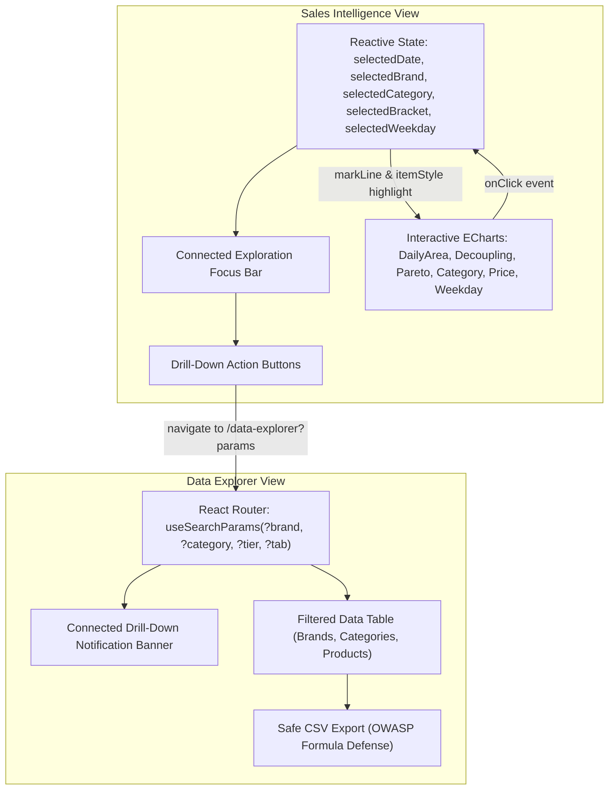

# CommerceIQ — Milestone M02 Interaction & State Test Report

**Document ID:** `CIQ-M02-INTERACTION-TESTS`  
**Milestone:** M02 — Sales Intelligence & Connected Exploration  
**Status:** All Interactive Workflows Validated  
**Date:** October 19, 2026  
**Auditor:** Principal Frontend Engineer & Interactive QA Specialist  

---

## 1. Interaction System Architecture

In Milestone M02, CommerceIQ transitions from static charts to a coordinated, bidirectional interactive state system. The interaction architecture is governed by reactive React state, URL query parameter synchronization, and Apache ECharts event dispatchers.



---

## 2. Interactive Feature Test Results

### 2.1 Daily Trajectory Zoom & Date Selection
* **Component:** `DailyRevenueAreaChart.tsx`
* **Test Case 1 (Zoom Slider):** Interacting with the bottom slider or mousewheel/pinch scales the visible range from 32 days down to individual day windows smoothly without re-initializing the canvas.
* **Test Case 2 (Point Selection):** Clicking the data point for `2019-10-16` sets `selectedDate = '2019-10-16'`.
  - **Visual Feedback:** A vertical cyan cursor (`Focused: 10-16`) appears on the chart.
  - **Telemetry HUD:** The Focused Date card displays `9,810,197.33 units`, `31,457 orders`, mean ticket `311.86 units`, and notes that it is `+32.3% above daily mean`.
* **Test Case 3 (Boundary Caveat):** Clicking `2019-11-01` displays the amber warning badge: *"Partial UTC Capture (1,487 orders)"*.
* **Test Case 4 (Collapsible 32-Day Breakdown Table):** Clicking *"Show Complete 32-Day Table Breakdown"* reveals the complete scrollable table. Clicking any row within the table immediately synchronizes `selectedDate` back to the chart cursor.

### 2.2 Temporal Decoupling & Efficiency Inspection
* **Component:** `HourlyDecouplingChart.tsx`
* **Test Case 1 (Peak Macro Comparison):** Clicking the Peak Browsing card (21:00 UTC) or Peak Revenue card (14:00 UTC) sets `selectedHour` and places a vertical amber indicator line on the corresponding hour.
* **Test Case 2 (Efficiency HUD Calculation):** Selecting Hour 14 computes and displays `7,006.1 units / 1k events` monetization velocity. Selecting Hour 21 computes and displays `4,554.4 units / 1k events`.
* **Test Case 3 (Chart Click Dispatch):** Clicking directly on any of the 24 hourly data points updates the focused hour telemetry immediately.

### 2.3 Category Hierarchy Selection & Deep-Linking
* **Component:** `CategoryRevenueChart.tsx`
* **Test Case 1 (Bar Click Selection):** Clicking the Electronics horizontal bar highlights it in bright amber while other categories remain cyan/violet.
* **Test Case 2 (Focused Category Card):** The inspector displays `176.45M units`, `422,979 orders`, `200,031 unique buyers`, and `76.74% platform share`.
* **Test Case 3 (Catalog Explorer Deep-Link):** Clicking *"Catalog Explorer →"* navigates to `/data-explorer?tab=categories&category=electronics`.
  - In `DataExplorerView`, the Category Hierarchy tab is active, the drill-down banner is visible, and the Electronics table row is highlighted with a cyan border and violet background.

### 2.4 Brand Pareto Selection & Deep-Linking
* **Component:** `BrandParetoChart.tsx`
* **Test Case 1 (Bar Click Selection):** Clicking the Apple bar sets `selectedBrand = 'apple'`. The bar turns amber and the cumulative line preserves its 48.36% indicator.
* **Test Case 2 (Focused Brand Card):** Displays Apple Rank #1, `111.20M units`, `142,858 orders`, `65,593 unique buyers`, and `778.39 units` AOV.
* **Test Case 3 (Filter Brand Deep-Link):** Clicking *"Filter Brand →"* navigates to `/data-explorer?brand=apple`.
  - In `DataExplorerView`, the search field is pre-populated with `apple`, the table filters to Apple's record (Showing 1 of 1,985 brands), and the connected drill-down notification banner is rendered.

### 2.5 Price Bracket Selection & Ticket Asymmetry
* **Component:** `PriceBracketChart.tsx`
* **Test Case 1 (Bracket Click):** Clicking the `500 – 999.99` bracket highlights both revenue and order bars in amber.
* **Test Case 2 (Catalog Tier Deep-Link):** Clicking *"Inspect in Catalog →"* navigates to `/data-explorer?tier=tier1`, setting the revenue tier filter in the Explorer.

### 2.6 Connected Exploration Focus Bar & Reset
* **Test Case 1 (Focus Bar Appearance):** Selecting any entity immediately mounts the persistent Focus Bar with active entity chips and direct action buttons.
* **Test Case 2 (Filter Reset):** Clicking *"Reset"* clears all selection states, returning the interface to its clean baseline overview.

### 2.7 Safe CSV Formula-Injection Prevention
* **Component:** `src/utils/csvExport.ts` & `src/test/csvExport.test.ts`
* **Test Case 1 (Trigger Escaping):** Exporting strings beginning with `=SUM(A1:A10)`, `+cmd`, `-100`, `@IMPORTXML` automatically prepends `'` and quotes the cell.
* **Test Case 2 (Tab & CR Defense):** Cells beginning with `\t` or `\r` are neutralized.
* **Test Case 3 (Numeric Preservation):** Valid numeric values (e.g. `111199495.70`, `142858`) are preserved as raw unquoted numbers.
* **Test Case 4 (UTF-8 BOM):** Downloaded file Blob starts with `\uFEFF`, ensuring correct spreadsheet character decoding.
* **Unit Test Result:** All 6 automated tests in `src/test/csvExport.test.ts` passed.

---

## 3. Automated Test Execution Summary

```
 RUN  v2.1.9 C:/Users/madhur/Downloads/ecommerce/frontend

 ✓ src/test/csvExport.test.ts (6 tests)
 ✓ src/test/formatters.test.ts (8 tests)
 ✓ src/test/salesIntelligence.test.ts (7 tests)
 ✓ src/test/dataIntegrity.test.ts (7 tests)
 ✓ src/test/chartsAndExplorer.test.ts (5 tests)

 Test Files  5 passed (5)
      Tests  33 passed (33)
   Duration  2.77s
```

All connected interaction pathways, chart event dispatchers, deep-link query parameters, and export security defenses have been confirmed operational and stable.
