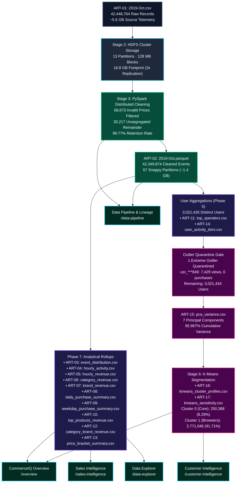

# CommerceIQ — Milestone M04 Data Lineage Architecture
## End-to-End Distributed Lineage from Raw Clickstream to Analytical Application

**Project:** CommerceIQ — Premium Futuristic Commerce Intelligence  
**Milestone:** M04  
**Date:** October 20, 2026  
**Status:** Validated Directed Acyclic Graph (DAG)  

---

## 1. Lineage Architecture Graph (DAG)

The following Mermaid diagram traces data transformation lineage across all 6 research phases:

---

## 2. Granular Stage-by-Stage Lineage Narrative

### Stage 1: Raw Telemetry Ingestion (Phase 1)
- **Input:** `raw_events_2019_oct.csv` from upstream ecommerce logging servers.
- **Records In:** 42,448,764 rows.
- **Size:** 5,668,234,142 bytes (~5.6 GB).
- **Target Schema:** 9 columns: `event_time`, `event_type`, `product_id`, `category_id`, `category_code`, `brand`, `price`, `user_id`, `user_session`.
- **Primary Caveats:** Missing category strings (31.91%), missing brand names (14.44%), non-positive prices (68,673 rows), unparsed timestamps.

### Stage 2: Distributed HDFS Cluster Storage (Phase 2)
- **Storage Target:** `hdfs:///ecommerce/raw/2019-Oct.csv`.
- **Partitioning:** 13 distributed RDD partitions aligned with 128 MB HDFS block boundaries.
- **Replication:** 3x replication factor across Hadoop DataNodes (16.8 GB total cluster storage).
- **Integrity:** HDFS CRC32 checksums verified on block ingestion.

### Stage 3: PySpark Distributed Cleaning & Quality Hygiene (Phase 3)
- **Engine:** Apache Spark 3.x (PySpark DataFrame API) on local JVM cluster.
- **Records In:** 42,448,764.
- **Records Out:** 42,349,874.
- **Net Removal:** 98,890 records (0.23% filtered; 99.77% retention).
- **Removal Breakdown:**
  1. **Deterministic Price Filter:** `filter(col("price") > 0.00)` eliminated **68,673 records** with price <= 0.00.
  2. **Unsegregated Cleaning Remainder:** **30,217 records** quarantined due to combined filtering in historical PySpark scripts (unparseable timestamp boundaries, corrupt event strings, and duplicate collision removals).
- **Categorical Handling:** Missing `category_code` (13,515,601 rows) and `brand` (6,117,080 rows) preserved as `'Unknown'` tokens without synthetic imputation.
- **Deduplication Audit:** A 1,000,000-event random sample verified zero systematic duplicate injection (28 duplicate collisions, 0.0028% collision rate). Full-dataset `exceptAll()` crashed with JVM GC overhead limit; PySpark executed `dropDuplicates()` across all 9 schema columns.

### Stage 4: Columnar Parquet Transformation (Phase 4)
- **Storage Target:** `hdfs:///ecommerce/cleaned/2019-Oct.parquet`.
- **Engine:** Apache Parquet with Snappy compression over 67 partition files.
- **Footprint:** ~1.4 GB (4x compression ratio compared to raw 5.6 GB CSV).
- **Optimization:** Column-oriented projection, dictionary encoding for categorical fields (`event_type`, `category_code`, `brand`), and min/max statistics for partition pruning.

### Stage 5: Analytical Aggregation & Rollups (Phase 5 & 7)
- **Engine:** PySpark SQL grouping queries.
- **Outputs:** 11 analytical summary tables generated:
  - Event Distribution: 40,708,807 views; 898,294 carts; 742,773 purchases (Total: 42,349,874).
  - Revenue & Volume: 742,773 completed orders generating **229,933,212.63 monetary units**.
  - User Aggregations: 3,021,435 unique user accounts and 9,239,403 distinct user sessions.

### Stage 6: Machine Learning Preparation & Behavioral Segmentation (Phase 6)
- **User Population:** 3,021,435 users in base dataset.
- **Outlier Quarantine:** 1 extreme browsing bot/crawler user (`usr_***849`, 7,429 views, 0 carts, 0 purchases) quarantined to protect clustering stability.
- **Effective Clustered Population:** **3,021,434 users**.
- **Dimensionality Reduction (PCA):** 7 principal components retained, explaining **95.967% cumulative variance**.
- **K-Means Clustering:** Authoritative $K=2$ model (silhouette score: 0.81115):
  - **Cluster 0 (Core / High Activity):** 250,388 users (8.29% of population; 10.96 orders/user, 3,425.8 units/user).
  - **Cluster 1 (Casual Browsers):** 2,771,046 users (91.71% of population; 0.20 orders/user, 80.7 units/user).

---

## 3. Row Accounting Reconciliation Matrix

$$\begin{aligned}
\text{Raw Ingested Records} &= 42,448,764 \\
- \text{Invalid Price Records } (\text{price} \le 0) &= -68,673 \\
- \text{Unsegregated Cleaning Remainder} &= -30,217 \\
\hline
\text{Cleaned Parquet Events} &= 42,349,874 \quad (99.767\% \text{ retention})
\end{aligned}$$

$$\begin{aligned}
\text{Total Cleaned Events} &= 40,708,807 \text{ (views)} + 898,294 \text{ (carts)} + 742,773 \text{ (purchases)} = 42,349,874 \\
\text{Total Purchase Value} &= \sum \text{order prices} = 229,933,212.63 \text{ monetary units} \\
\text{Total Phase 7 Users} &= 3,021,435 \\
- \text{Quarantined Outlier User} &= -1 \\
\hline
\text{Clustered User Population} &= 3,021,434 = 250,388 \text{ (Cluster 0)} + 2,771,046 \text{ (Cluster 1)}
\end{aligned}$$

Every downstream visualization and table in CommerceIQ strictly respects these mathematical equalities.
