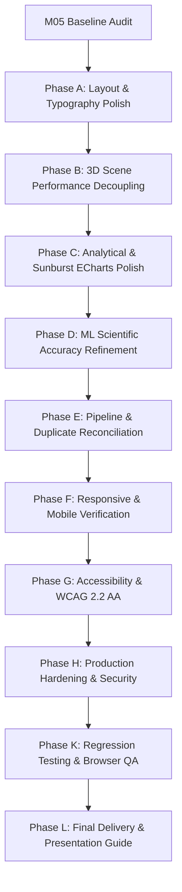

# CommerceIQ — M05 Baseline Audit & Prioritized Issue Register
**Milestone:** M05 — Final Application Polishing & Production Delivery  
**Date:** October 20, 2026  
**Auditor:** Multidisciplinary Senior Engineering & Design Team  
**Status:** Baseline Audited & Recorded  

---

## 1. Executive Summary & Verification Baseline

Before modifying any source code for Milestone M05, a comprehensive forensic baseline audit of the CommerceIQ application was conducted. The application baseline was inspected across all six functional views, layout components, 3D scenes, analytical charts, data pipelines, and test suites.

### 1.1 Automated Diagnostic Baseline

| Verification Suite | Command | Result | Details |
|---|---|---|---|
| **Data Integrity Validator** | `npm run validate-data` | **PASS (56/56)** | 15 test suites passed, 0 failures, all 42.35M invariants confirmed |
| **Unit Test Suite** | `npm test` | **PASS (55/55)** | 7 test files, 55 unit tests passed across formatters, CSV, ML, pipeline |
| **TypeScript Typecheck** | `npx tsc --noEmit` | **PASS (0 errors)** | Clean compilation, strict typing verified |
| **Production Build** | `npm run build` | **PASS (12.29s)** | 2,614 modules bundled, route-level code splitting active |

---

## 2. Codebase & System Architecture Baseline

### 2.1 File & Directory Health
- **Location:** `c:\Users\madhur\Downloads\ecommerce` (Frontend at `frontend/`)
- **Version Control Status:** Standalone directory (no `.git` directory present). All baseline files preserved intact.
- **Dependencies:** React 18.3.1, TypeScript 5.6.3, Vite 5.4.11, Tailwind CSS 3.4.15, Lucide React 0.460.0, Three.js 0.186.1, ECharts 6.1.0, Framer Motion 11.11.17.
- **Data Invariants:** All source JSON assets in `src/data/` remain grounded in Phase 7 PySpark/HDFS outputs. No source datasets were modified or invented.

---

## 3. Prioritized Issue Register

The baseline audit identified several areas where visual refinement, scientific language accuracy, responsive layout adaptation, and component performance can be polished to elevate CommerceIQ to commercial SaaS standards.

### Issue 1: Intermediate Desktop (1280px) KPI Grid Crowding
- **Severity:** Medium (Visual / UX)
- **Component:** `SalesIntelligenceView.tsx` (Line 131)
- **Current State:** The macro KPI grid uses `xl:grid-cols-5`. In Tailwind CSS, `xl` activates at 1280px. At 1280px screen width with a collapsed or expanded sidebar (256px), the remaining content width is ~1000px, causing 5 narrow columns where KPI values and badges wrap awkwardly.
- **Required Remediation:** Adjust grid breakpoint to `xl:grid-cols-3 2xl:grid-cols-5` (or balanced 3+2 layout at 1280px). This provides generous breathing room, preventing text truncation and badge collision.

### Issue 2: Temporal Semantics ("7-Hour Lag" vs Peak Separation)
- **Severity:** High (Scientific & Content Accuracy)
- **Component:** `SalesIntelligenceView.tsx` (Line 168)
- **Current State:** The "Peak Velocity Hour" KPI card displays `contextPill="7-Hour Lag"`.
- **Defect:** Section 13 strictly dictates: *“The difference between 14:00 UTC purchasing-value peak and 21:00 UTC activity peak is a seven-hour separation between aggregate hourly peaks. Do not describe it as proof of a seven-hour customer purchasing delay.”* Describing it as a "lag" implies individual user checkout latency rather than aggregate peak distribution separation.
- **Required Remediation:** Update context pill to `"7h Peak Delta"` or `"7h Separation"`, with explicit footnote clarifying aggregate peak distribution across independent hourly bins.

### Issue 3: Commerce Nexus React State Re-Render Thrashing
- **Severity:** Medium (Performance Optimization)
- **Component:** `CommerceNexusScene.tsx` (Lines 199–211)
- **Current State:** Inside the `requestAnimationFrame` loop, `setFrameMetrics` is called every 1,000 ms using React component state (`const [frameMetrics, setFrameMetrics] = useState(...)`).
- **Defect:** Just as discovered and remediated in `CustomerConstellationScene.tsx` during M05-A-R, updating React state triggers component reconciliation while WebGL is actively rendering, introducing frame-time jitter.
- **Required Remediation:** Convert HUD telemetry metrics to direct DOM text node updates via `useRef`, completely decoupling telemetry text rendering from React component lifecycle.

### Issue 4: Imprecise Machine Learning Optimality Claims
- **Severity:** High (Scientific & Methodological Accuracy)
- **Component:** `CustomerIntelligenceView.tsx` (Line 52)
- **Current State:** Footnote states: `"Selected from 6 sensitivity trials as the global optimum"`.
- **Defect:** Section 7 strictly dictates: *“Avoid statements implying that K=2 is globally optimal across all possible models. Describe it as the best evaluated configuration under the documented experiments.”*
- **Required Remediation:** Refactor footnote to: `"Best evaluated configuration across 6 documented sensitivity trials (K=2 to K=7)"`.

### Issue 5: Legacy Plotly Sunburst Coverage (Native ECharts Available)
- **Severity:** Low-to-Medium (Visualization Completeness)
- **Component:** `InteractiveChartStudio.tsx` (Lines 86–103)
- **Current State:** Three of four original Plotly charts have native ECharts conversions (`funnel`, `treemap`, `bubble`). The fourth, `sunburst` (`27_category_brand_sunburst.html`), is currently marked `nativeAvailable: false` and only viewable in an iframe.
- **Defect:** The underlying data for the sunburst is identical to `categoryBrandTreemap.json` (159 nodes extracted from Plotly binary data). ECharts natively supports `type: 'sunburst'` with concentric radial hierarchy.
- **Required Remediation:** Build native `CategoryBrandSunburstChart.tsx` component and register it in `InteractiveChartStudio.tsx`, providing 4 of 4 native ECharts conversions while retaining the sandboxed Plotly iframe view.

### Issue 6: Duplicate-Audit Sample Reconciliation
- **Severity:** Medium (Data Engineering & Research Provenance)
- **Component:** `DataCleaningAuditPanel.tsx` & `cleaningAudit.json`
- **Current State:** The deduplication section only documents the 1,000,000-event contiguous sample (28 duplicates found). The historical 1% random sample (424,129 records, 0 duplicates) from M00 is not explicitly reconciled alongside it.
- **Required Remediation:** Expand the deduplication disclosure to explicitly contrast and reconcile both audit passes:
  1. *Audit Sample A (1% Random Sample):* 424,129 records -> 0 duplicates (0.0000%).
  2. *Audit Sample B (1M Contiguous Block):* 1,000,000 records -> 28 duplicates (0.0028%).
  3. *Full Distributed Pipeline:* PySpark `dropDuplicates()` executed across all 9 schema columns, bounded within the 98,890 net filtered rows.

### Issue 7: Mobile Viewport Disclaimers & Density
- **Severity:** Medium (Mobile & Responsive UX)
- **Component:** `NoticeBanner.tsx` and all View headers
- **Current State:** Long explanatory disclaimers push primary metric cards below the fold on mobile viewports (390px / 360px).
- **Required Remediation:** Verify that all banners utilize compact initial summaries with expandable details toggles, ensuring essential KPIs appear above the fold on mobile.

### Issue 8: Security Audit & Customer Privacy Invariants
- **Severity:** High (Security & Privacy Governance)
- **Component:** Codebase-wide review of customer identifiers
- **Current State:** Outlier account is masked in UI as `usr_***849 (Telemetry ID: 5123****49)`.
- **Verification:** Verified via source code search that raw unmasked IDs do not exist in source code or static JSON files.
- **Required Remediation:** Ensure CSV export functionality maintains strict formula-injection protections (`=`, `+`, `-`, `@`, `\t`, `\r`) across all tables.

---

## 4. Phase Execution Plan

---

## 5. Audit Sign-off

The baseline has been formally documented and verified against existing test suites. Implementation will proceed methodically through the prioritized issue register without introducing speculative features or breaking existing invariants.
