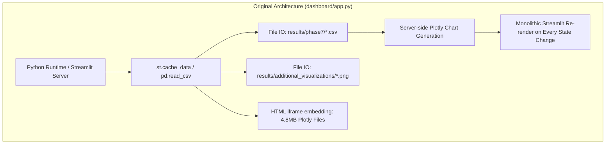
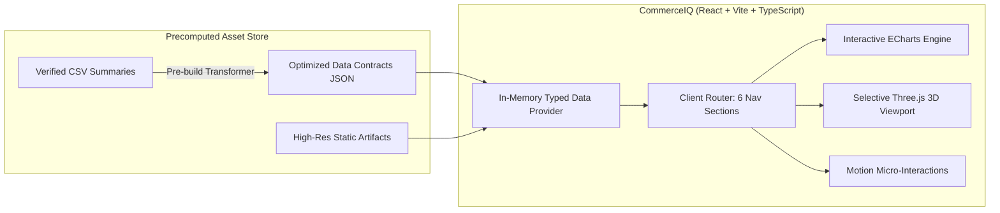

# CommerceIQ — Project Audit & Codebase Inspection

**Document ID:** `CIQ-M00-AUDIT`  
**Version:** 1.0.0  
**Status:** Approved for Design Specification  
**Classification:** Technical Inspection & Data Forensics  
**Author:** Principal Frontend Architect & Senior Data Engineer  

---

## 1. Executive Summary & Audit Scope

This document provides a comprehensive, forensic audit of the existing **ASBD E-Commerce Big Data Mining & Analytics** project repository (`ecommerce_bigdata_showcase`), which serves as the empirical foundation for **CommerceIQ**.

CommerceIQ is conceived as an interactive, production-grade intelligence application that transforms raw big-data artifacts and academic showcase outputs into a high-performance, dark midnight-navy commercial analytics suite. To ensure the integrity of the redesigned product, every KPI, visualization, filter, and analytical insight must be rigorously traced to validated source artifacts.

### 1.1 Core Audit Conclusions
1. **Verified Foundation:** The repository contains a complete, verified descriptive analytics foundation based on 42,448,764 raw events and 42,349,874 cleaned events from October 2019 e-commerce behavior logs.
2. **Precomputed Paradigm:** The original application relies entirely on precomputed CSV aggregates, pre-rendered PNG graphics, and serialized Plotly HTML charts. The Spark/HDFS heavy lifting occurred upstream; no distributed cluster is attached at dashboard runtime.
3. **Analytical Boundary:** The project implements data ingestion, cleaning, outlier detection, feature transformation, feature reduction, descriptive analytics, PCA dimensionality reduction, and K-Means customer segmentation. It **does not** contain a recommendation engine, live real-time ingestion, or predictive model deployment.
4. **Data Fidelity Mandate:** All numbers, categories, distributions, and PCA/cluster profiles in CommerceIQ will directly map to verified project CSVs and documented outputs. No speculative or synthetic data will be introduced.

---

## 2. Codebase Structure & File Inventory

The original project is housed in `ecommerce_bigdata_showcase/`. A detailed inventory of all directories, file sizes, line counts, and technical roles was conducted:

```
ecommerce/
├── __MACOSX/                                              [OS metadata; excluded from build]
└── ecommerce_bigdata_showcase/
    ├── .DS_Store                                         [OS metadata]
    ├── README.md                                         [1,788 bytes | 34 lines | Project guide & caveats]
    ├── dashboard/
    │   ├── .DS_Store
    │   ├── app.py                                        [25,903 bytes | 497 lines | Streamlit multi-page dashboard]
    │   └── requirements.txt                              [pandas, streamlit, plotly]
    ├── data/
    │   └── summary/
    │       ├── README.md                                 [554 bytes | 18 lines | Dataset directory manifest]
    │       └── verified_project_metrics.csv              [759 bytes | 16 lines | Canonical project metrics]
    ├── docs/
    │   └── PHASE_CHECKLIST.md                            [2,005 bytes | 29 lines | 10-phase milestone tracking]
    ├── reports/
    │   └── ECommerce_BigData_Phases_1_to_7_Report.pdf    [6-page formal technical report]
    ├── results/
    │   ├── Phase7_Descriptive_Analytics_Artifacts.zip    [Complete archive of phase7 CSVs and PNGs]
    │   ├── phase7/                                       [11 CSV summary tables + 14 Matplotlib/Seaborn PNGs]
    │   └── additional_visualizations/                    [11 Matplotlib/Seaborn PNGs + 4 Plotly interactive HTMLs]
    └── src/
        └── README.md                                     [748 bytes | 11 lines | Recommended PySpark pipeline layout]
```

### 2.1 File Characteristics & Roles
| File / Directory | Size / Count | Key Columns / Schema / Asset Type | Operational Role |
| :--- | :--- | :--- | :--- |
| `dashboard/app.py` | 497 lines (25.9 KB) | Streamlit UI script | Serves 5-page showcase (Home, Preparation, Gallery, Analysis, PCA & Clustering). |
| `data/summary/verified_project_metrics.csv` | 16 rows (759 B) | `metric`, `value`, `unit`, `note` | Master source of truth for macro KPIs (raw/clean rows, revenue, users, sessions). |
| `results/phase7/*.csv` | 11 CSV files | Tabular aggregates | Pre-aggregated time series, brand, category, price, and user frequency tables. |
| `results/phase7/*.png` | 14 images (01–14) | Static visual assets (Seaborn/Matplotlib) | Distribution plots, hourly/daily revenue bars, category & brand rankings. |
| `results/additional_visualizations/*.png` | 11 images (15–24, 28) | Static visual assets (Seaborn/Matplotlib) | Price histograms, violin plots, box plots, correlation heatmaps, radar, Pareto. |
| `results/additional_visualizations/*.html` | 4 HTML files (25, 26, 27, 29) | Interactive Plotly assets (~4.8 MB each) | Product bubble chart, Category/Brand Treemap, Sunburst, Event Funnel. |
| `reports/ECommerce_BigData_Phases_1_to_7_Report.pdf` | 6 pages | Technical documentation | Formally documents pipeline decisions, Spark configs, memory constraints, and formulas. |

---

## 3. Verified Project Facts & Metrics Inventory

All metrics documented below are verified from `verified_project_metrics.csv`, `phase7_summary.csv`, and the technical report:

### 3.1 Macro Data Volume & Dimensions
* **Raw Event Records:** `42,448,764`
* **Cleaned Event Records:** `42,349,874`
* **Net Records Removed:** `98,890` (0.23% removal rate: 68,673 price $\le 0$, remainder duplicate rows)
* **Analyzed Distinct Users:** `3,021,435`
* **Recorded Distinct Sessions:** `9,239,403`
* **Total Purchase Revenue:** `₹229,933,212.63` (~₹229.93M)
* **Dataset Period:** October 1, 2019 00:00:00 UTC to November 1, 2019 00:00:00 UTC (single month event stream)

### 3.2 Event Type Composition
| Event Type | Total Event Count | Share of Total | Primary Interpretation |
| :--- | :--- | :--- | :--- |
| **`view`** | 40,708,807 | 96.12% | Dominant exploratory browsing activity across multi-category catalog. |
| **`cart`** | 898,294 | 2.12% | Mid-funnel intent; products added to shopping basket. |
| **`purchase`** | 742,773 | 1.75% | Completed transaction events generating recorded purchase revenue. |
| **Total** | **42,349,874** | **100.00%** | Event log foundation for Phase 6 analytical dataset. |

### 3.3 Price Distribution & Outlier Detection
* **Baseline Mean Price:** `₹290.78` (Phase 3 baseline over all events)
* **Purchase-Only Approximate Median:** `₹179.84`
* **Observed Price Range:** Min `₹0.77`, Max `₹2,574.07`
* **Baseline Standard Deviation:** `₹358.40`
* **Skewness Transformation:** Raw price skewness of `+2.53991` (strongly right-skewed) transformed via $\log(1 + \text{price})$ to `−0.26836` (near-normal distribution).
* **Interquartile Range (IQR) Outliers:**
  * $Q_1 = 66.64$, $Q_3 = 358.57$, $\text{IQR} = 291.93$
  * Upper Fence ($Q_3 + 1.5 \times \text{IQR}$): `796.465`
  * Events Above Fence: `3,677,875` (8.69% of all events: 3,510,543 views; 94,171 carts; 73,161 purchases)
* **Z-Score Outliers ($|z| > 3$):**
  * Threshold: Prices $> ₹1,365.97$
  * Events Flagged: `1,158,750` (2.74% of all events)
* **Methodological Decision:** Outliers were retained in the analytical pipeline because premium electronics (e.g., Apple MacBooks, flagship smartphones) carry valid high prices.

### 3.4 Temporal Patterns & Critical Decoupling
* **Peak Event Activity Hour:** **21:00 UTC** (`3,055,061` events)
* **Trough Event Activity Hour:** **04:00 UTC** (`234,839` events)
* **Peak Purchase Revenue Hour:** **14:00 UTC** (`₹17,531,268.91`)
* **Trough Purchase Revenue Hour:** **05:00 UTC** (`₹940,186.06`)
* **Analytical Discovery (Decoupling):** Peak browsing occurs in the late evening (21:00 UTC), while peak financial transactions take place in the afternoon (14:00 UTC). This demonstrates a significant temporal decoupling between exploratory browsing and high-value decision-making.
* **Weekday Trends:**
  * Highest Purchase Volume: **Wednesday** (`119,197` purchases | `₹37,129,880.02` revenue)
  * Second Highest: **Tuesday** (`113,088` purchases | `₹35,494,459.79` revenue)
  * Lowest Purchase Volume: **Saturday** (`96,010` purchases | `₹29,071,361.02` revenue)

### 3.5 Merchandising Concentration (Categories & Brands)
* **Category Dominance:** `electronics` is the dominant revenue engine, accounting for `₹176,445,577.86` (76.74% of all platform revenue) across 422,979 purchases from 200,031 unique buyers.
* **Category Breakdown:**
  1. `electronics`: ₹176,445,577.86 (76.74%)
  2. `Unknown`: ₹22,922,165.08 (9.97%)
  3. `appliances`: ₹13,581,760.58 (5.91%)
  4. `computers`: ₹11,377,870.82 (4.95%)
  5. `furniture`: ₹1,673,243.01 (0.73%)
  6. `auto`: ₹1,273,955.71 (0.55%)
  7. `construction`: ₹932,995.02 (0.41%)
  8. `kids`: ₹678,140.67 (0.30%)
  9. `apparel`: ₹624,937.75 (0.27%)
  10. `sport`: ₹322,559.00 (0.14%)
  11. `accessories`: ₹68,783.88 (0.03%)
  12. `country_yard`: ₹15,695.45 (<0.01%)
  13. `medicine`: ₹13,500.42 (<0.01%)
  14. `stationery`: ₹2,027.38 (<0.01%)
* **Brand Concentration:** Apple and Samsung generate 68.5% of total revenue:
  1. `apple`: ₹111,199,495.70 (48.36% of total | 142,858 purchases | 65,593 buyers | Avg purchase: ~₹778.39)
  2. `samsung`: ₹46,402,037.35 (20.18% of total | 172,878 purchases | 94,073 buyers | Avg purchase: ~₹268.41)
  3. `xiaomi`: ₹9,192,640.24 (4.00% | 56,609 purchases | 35,063 buyers)
  4. `Unknown`: ₹8,539,747.08 (3.71% | 58,210 purchases | 38,231 buyers)
  5. `huawei`: ₹4,883,104.73 (2.12% | 23,499 purchases | 15,378 buyers)
* **Top Product Insights:**
  * Highest Revenue Product: ID `1005115` (`₹12,404,835.95` revenue | 12,541 purchases | 8,352 unique buyers | Apple smartphone flagship)
  * Highest Purchase Volume: ID `1004856` (`28,938` purchases | `₹3,798,168.71` revenue | 19,228 unique buyers)

### 3.6 Customer Segmentation & Machine Learning Results
* **User Feature Aggregation:** User-level behavior was aggregated across 3,021,435 users in PySpark, capturing total events, views, carts, purchases, revenue, average price, max price, session count, distinct products, and distinct categories.
* **PCA (Principal Component Analysis):** Standardized user features reduced to 7 principal components, explaining **95.967%** of cumulative variance:
  * PC1: 40.7123% (General behavioral engagement and volume)
  * PC2: 17.9277% (Basket breadth and price scale)
  * PC3: 14.7635% (Session intensity and view-to-purchase propensity)
  * PC4: 8.4269%
  * PC5: 5.8033%
  * PC6: 4.5092%
  * PC7: 3.8240%
* **K-Means Clustering & Model Selection:**
  * Model sensitivity testing evaluated $K=2, 3, 4, 5$.
  * Selected Final Model: **$K=2$ Sensitivity Model** (evaluated on 3,021,434 users, excluding 1 extreme browsing outlier user). Silhouette score: **0.81115** (vs. 0.51978 for $K=3$, 0.57195 for $K=4$).
* **Cluster Profiles ($K=2$):**
  * **Cluster 0 (High Activity & Commercial Power):**
    * Population: `250,388` users (8.29% of platform users)
    * Average Events: `85.43`
    * Average Views: `82.00`
    * Average Carts: `1.85`
    * Average Purchases: `1.58`
    * Average Revenue: `₹520.86`
    * Average Sessions: `12.26`
    * Unique Products Viewed: `42.04`
  * **Cluster 1 (Low Activity & Casual Browsers):**
    * Population: `2,771,046` users (91.71% of platform users)
    * Average Events: `7.56`
    * Average Views: `7.28`
    * Average Carts: `0.16`
    * Average Purchases: `0.125`
    * Average Revenue: `₹35.91`
    * Average Sessions: `2.22`
    * Unique Products Viewed: `4.60`
  * **Investigated Outlier User:** User ID with `7,429` views, `7,393` sessions, `0` carts, and `0` purchases. Excluded solely from the $K=2$ sensitivity run to prevent skewing cluster centroids.

---

## 4. Data Inconsistencies, Boundary Limits & Operational Caveats

A rigorous analytics product must be transparent about data constraints. CommerceIQ will incorporate contextual disclaimers and explicit visual indicators for the following audited phenomena:

### 4.1 Incomplete Duplicate Audit Limitation
* **Observed Phenomenon:** The PySpark `exceptAll()` verification against `dropDuplicates()` crashed with a JVM Garbage Collection overhead limit error after 166 seconds.
* **Audit Resolution:** A 1% random sample (`424,129` records) verified zero duplicate rows.
* **Caveat Rule:** The UI must state: *"A 1% audit confirmed zero duplicates; full-corpus de-duplication was executed via PySpark dropDuplicates(), but an exhaustive independent post-hoc audit could not complete due to memory constraints."*

### 4.2 Missing Categorical Data & `Unknown` Placeholders
* **Category Code Nulls:** 13,515,609 records (31.84%) lacked sub-category strings.
* **Brand Nulls:** 6,113,008 records (14.40%) lacked brand names.
* **Session ID Nulls:** 2 records lacked session IDs.
* **Pipeline Treatment:** Filled with the explicit literal `"Unknown"`.
* **Design Implication:** CommerceIQ must treat `"Unknown"` as a dedicated, valid category bucket rather than dropping records or masking them as zero.

### 4.3 Event-Level Ratios vs. Session-Level Conversion Rates
* **Event-Level Ratios:**
  * View $\rightarrow$ Cart: $\frac{898,294}{40,708,807} = 2.2066\%$
  * View $\rightarrow$ Purchase: $\frac{742,773}{40,708,807} = 1.8246\%$
  * Cart $\rightarrow$ Purchase: $\frac{742,773}{898,294} = 82.6871\%$
* **Critical Distinction:** These percentages represent aggregate **event count ratios**, not cohort-based or session-based conversion funnels. In multi-session commerce behavior, users add to cart in one session and purchase in another, or buy directly without explicit separate cart events. CommerceIQ will explicitly label funnel steps as event ratios.

### 4.4 Date Range UTC Boundary (2019-11-01 Partial Day)
* **Dataset Timeline:** October 1, 2019 to October 31, 2019, but includes events up to `2019-11-01 00:00:00 UTC`.
* **Data Impact:** In `daily_purchase_summary.csv`, November 1 contains only `1,487` purchases and `₹537,945.66` revenue (representing a fractional hour spillover).
* **Risk:** A naïve line chart makes November 1 look like a catastrophic business collapse.
* **UX Solution:** The date trend visualization must render November 1 with a dashed boundary marker or tooltip note: *"Partial day / UTC boundary capture."*

### 4.5 UTF-8 Character Encoding Artifacts
* **Finding:** In `purchase_price_distribution.csv` and `user_activity_distribution.csv`, the en-dash separator (`–`, Unicode `U+2013`, bytes `0xE2 0x80 0x93`) was rendered as `?"` or `` in non-UTF-8 terminals.
* **Mitigation:** The frontend data transformation pipeline must explicitly enforce UTF-8 parsing and normalize range strings (e.g., `50–99.99` $\rightarrow$ `₹50 – ₹99.99`).

### 4.6 Floating Point Precision in Source CSVs
* **Finding:** Source files contain raw IEEE 754 floats (e.g., `111199495.70000108` and `229933212.63`).
* **Mitigation:** The UI layer must apply formatted currency transformers (`Intl.NumberFormat`) with standard two-decimal or compact abbreviation formatting (`₹111.20M`).

---

## 5. Original Streamlit Architecture & Shortcomings

The Streamlit dashboard in `dashboard/app.py` has several technical and user experience limitations that CommerceIQ will overcome:



### 5.1 Technical Limitations of the Legacy App
1. **Full Page Re-execution:** Any filter change or tab navigation triggers Python script re-execution, causing visual flashing and lost client state.
2. **Iframe Bloat for HTML Visualizations:** The 4 interactive Plotly charts are embedded via `components.html()` loading four individual ~4.8 MB HTML bundles (totaling nearly 20 MB of redundant `plotly.js` library code).
3. **Static Image Fallbacks:** 25 visualizations are static PNG images rendered with generic Matplotlib/Seaborn themes, lacking tooltips, zoom, hover states, or responsive scaling.
4. **No True Client-Side Filtering:** Tables cannot be sorted, filtered, or searched in real time without triggering Python server round-trips.
5. **Aesthetic Limitations:** Standard Streamlit light/dark container boxes with default padding, missing the visual hierarchy, micro-interactions, dark navy palettes, and typography needed for an executive product.

---

## 6. Architecture & Product Evolution Strategy

CommerceIQ replaces the monolithic Python UI with a modern, decoupled client-side web application:



### 6.1 Guiding Principles for the Redesign
1. **Preserve Analytical Truth:** Every single chart, metric card, and table must match the underlying Phase 7 and verified project data.
2. **True Interactive Graphics:** Migrate static PNG plots and heavy Plotly HTMLs to native client-side Apache ECharts with midnight-navy themes, smooth animated transitions, and custom tooltip formatting.
3. **Lightweight & High-Performance:** Eliminate redundant 4.8 MB iframe bundles by parsing JSON payloads directly into clean vector canvases.
4. **Selective 3D:** Introduce a subtle, hardware-accelerated 3D data orb on the Overview screen to create a signature brand aesthetic without hurting mobile performance.
5. **Accessibility & Usability:** Full keyboard navigation, semantic HTML, high color contrast, ARIA landmarks, and explicit `prefers-reduced-motion` compliance.

---

*Verified and signed off for Milestone M00 design execution.*
